# Проверка BiletY: что проверено и скриншоты

Проверка 23 ноября 2026: сервер на своём компьютере с **пробным ИИ** (без денег), браузер Chromium в размерах iPhone 13 и iPad Pro 11. Настоящий YandexGPT и Yandex Vision здесь не проверялись: ключа в среде разработки нет. Их проверишь сам — шаг 6 в [yandex_cloud.md](yandex_cloud.md).

## Автотесты (`python -m pytest -q tests`) — 20 из 20

- вход: неверный пароль, верный, пароль хранится хэшем; смена пароля выкидывает другие устройства;
- материал: PDF (загрузка кусками), Word, PowerPoint, вставленный текст, фото и скан PDF через распознавание, понятные ошибки (старый .doc, нет материала, «материал слишком большой», распознавание не настроено), «откуда докуда», повторное использование текста без повторной загрузки;
- билеты по двум файлам: две темы, у каждого вопроса тема, нумерация по порядку;
- конспект по одному файлу: одна тема;
- ответ на вопрос: найден (с проверенной цитатой) и «В загруженных файлах ответа на этот вопрос нет»;
- вопросы: число и сложность из Настроек, виды и варианты проверены кодом, ответы считает сервер;
- большой материал: работа по частям, вопросов ровно столько, сколько заказано, ответ по подходящим кускам;
- история и удаление: после удаления нет ни результата, ни извлечённого текста;
- ключ ИИ не возвращается на экран и лежит в базе зашифрованным; расходы считаются; палитра сохраняется;
- «зависшая» задача → ошибка с «Повторить».

## Скриншоты (iPhone)

| | |
|---|---|
| Привет | 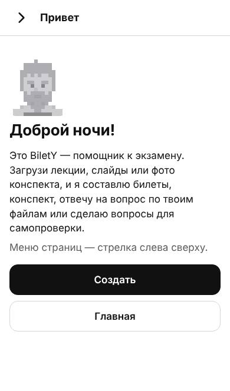 |
| Меню (стрелка слева сверху) | 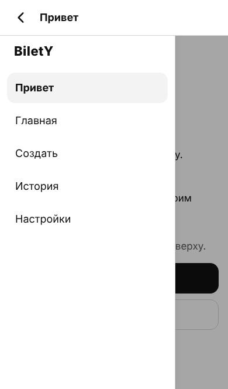 |
| Главная: философы | 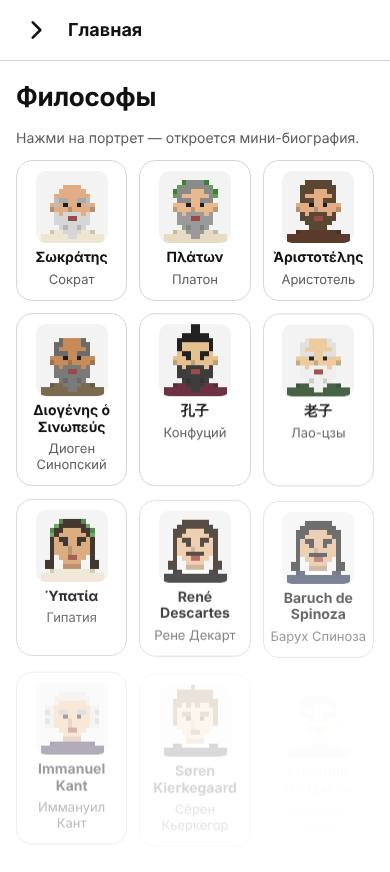 |
| Мини-биография | 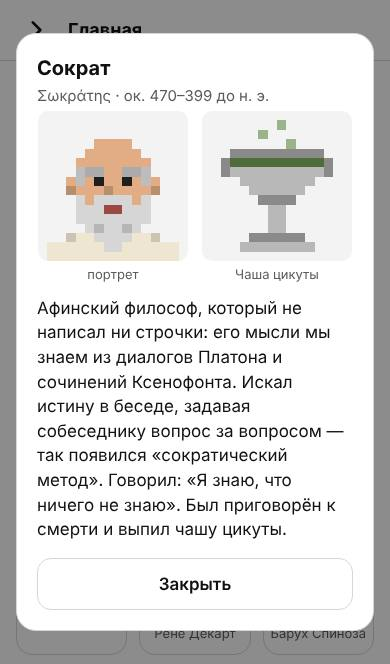 |
| Создать: три окошка | 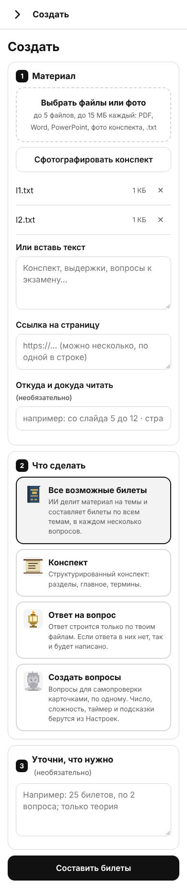 |
| Билеты (две темы) | 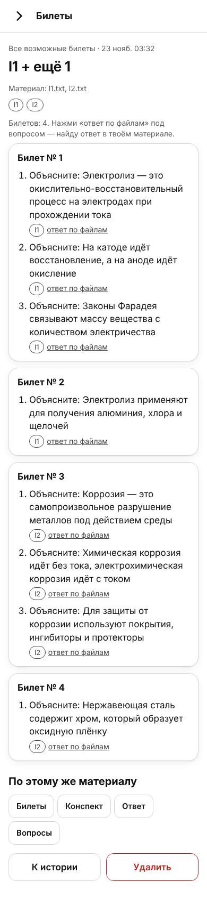 |
| «Ответ по файлам» из билета | 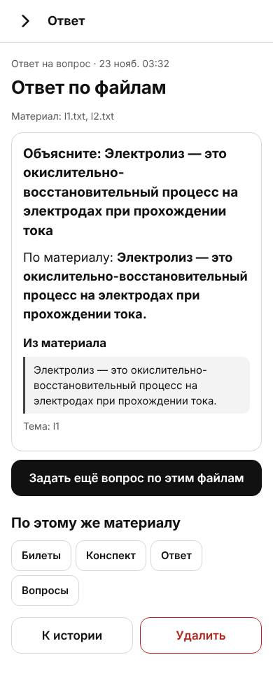 |
| Конспект | 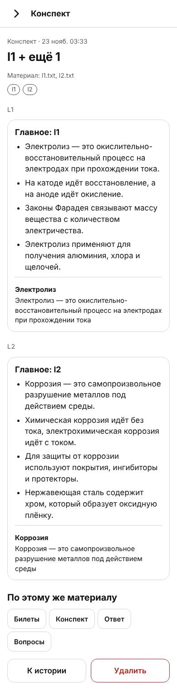 |
| Ответа в файлах нет | 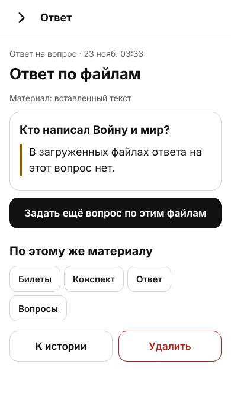 |
| Настройки вопросов | 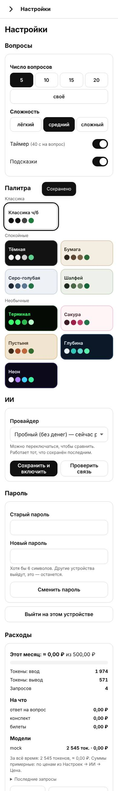 |
| Карточка с таймером | 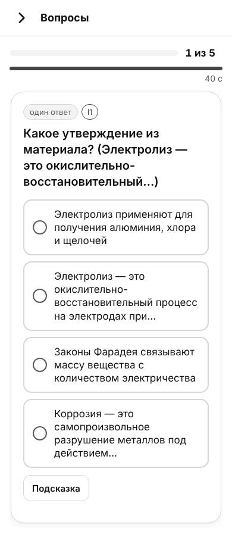 |
| После ответа | 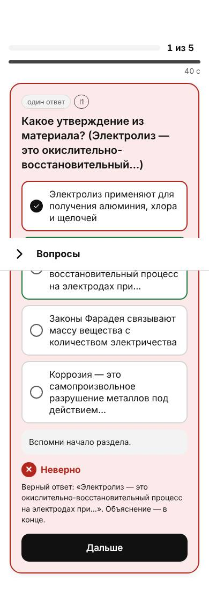 |
| Итог и объяснения | 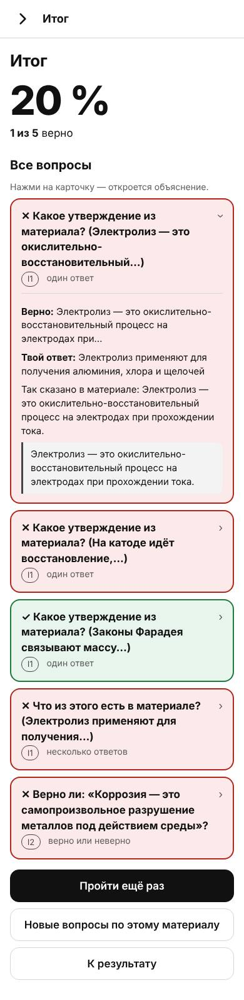 |
| История | 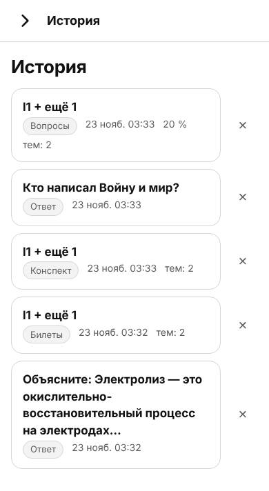 |
| Палитра «Неон» | 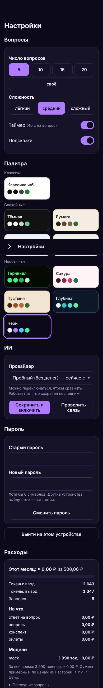 |

## Скриншоты (iPad)

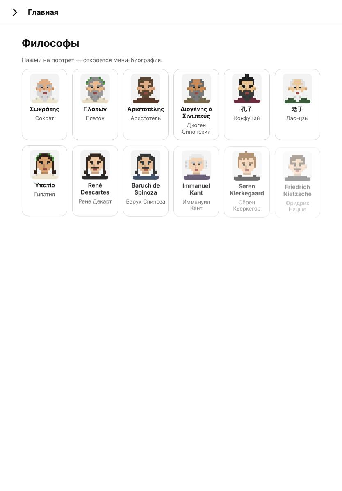 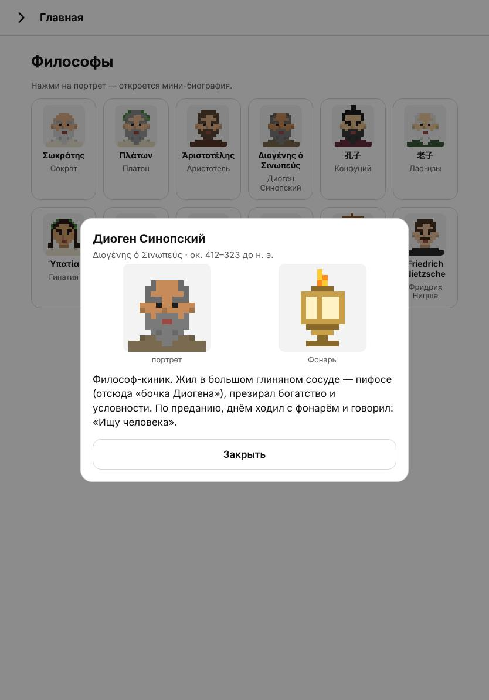 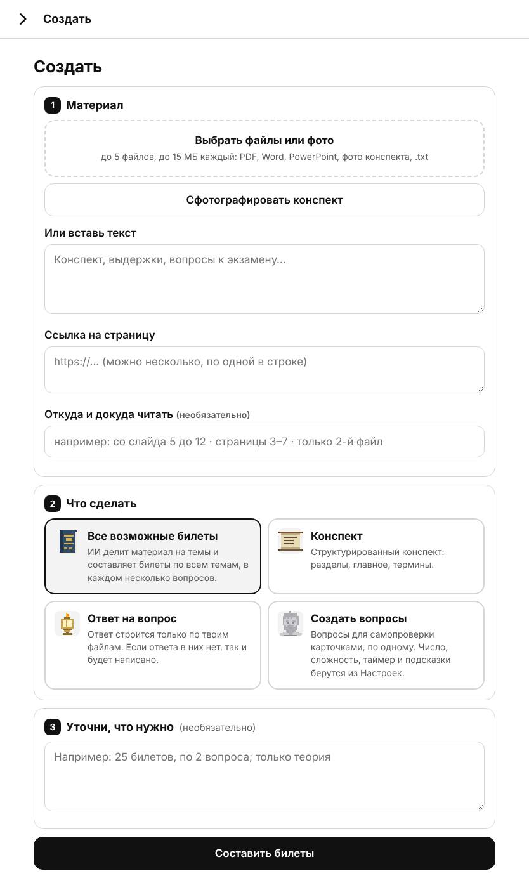

## Найдено и исправлено при проверке

- окно биографии оставалось открытым при переходе на другую страницу — теперь закрывается (и по Esc);
- у «Ответа» заголовок повторял вопрос — теперь «Ответ по файлам», вопрос в карточке;
- при большом материале вопросов могло получиться на один меньше — добавлен один добирающий запрос.
